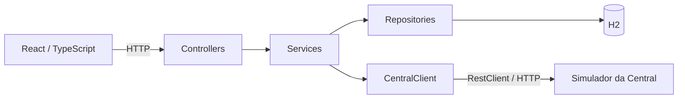
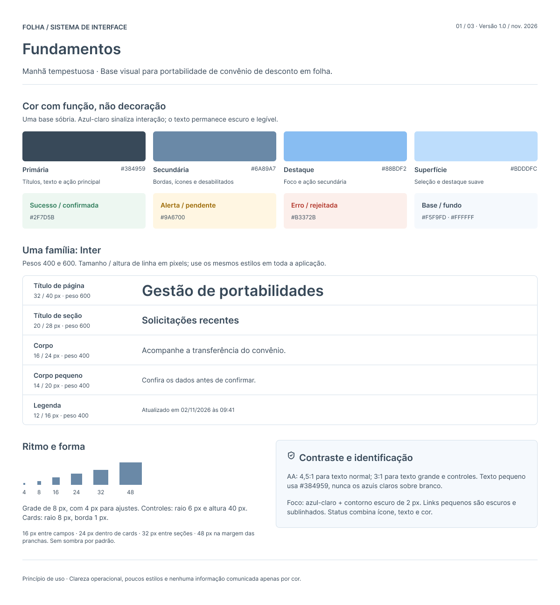
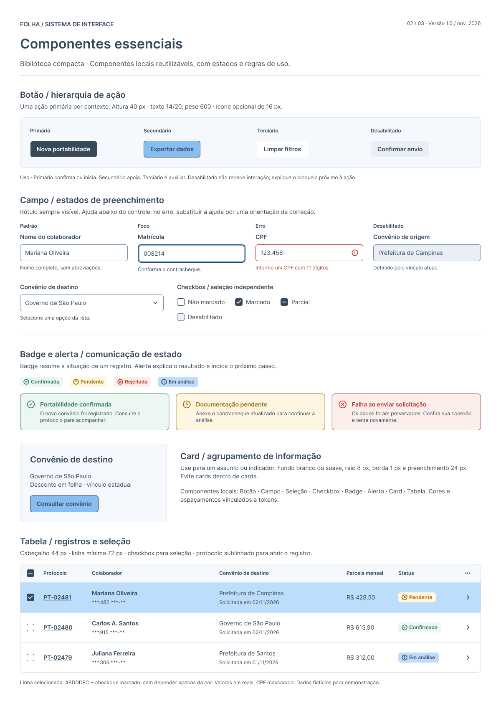
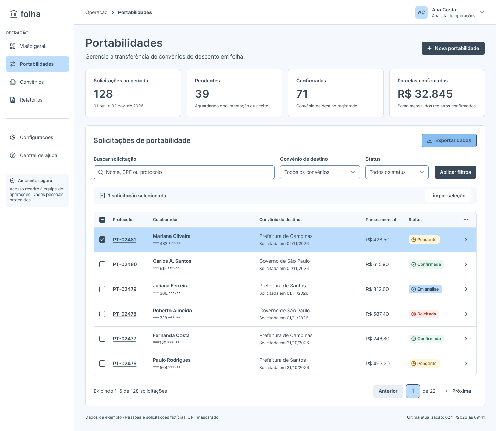
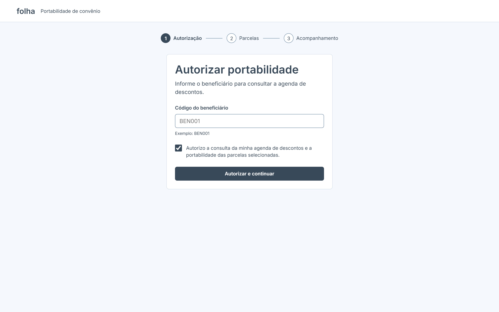
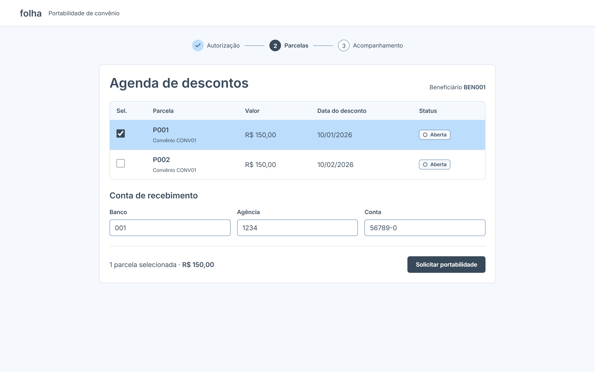
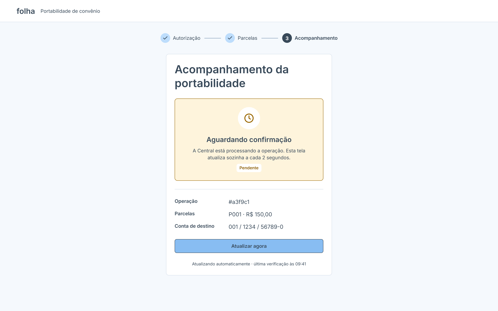

# Plataforma de Portabilidade de Convênio

Aplicação desenvolvida para o desafio técnico fullstack com Java e React. Permite registrar o consentimento de um beneficiário, consultar sua agenda de descontos, selecionar parcelas, informar a conta de destino e acompanhar uma solicitação de portabilidade até a confirmação ou rejeição.

A solução integra uma API Spring Boot, uma interface React com TypeScript e o simulador da Central de Convênios fornecido pelo desafio. A Central é consumida sem alterações em suas regras.

## Funcionalidades

- Registro de autorização (opt-in) com consentimento explícito na interface.
- Consulta da agenda de um beneficiário autorizado, exibindo valor, data de desconto e status.
- Seleção de uma ou mais parcelas abertas e preenchimento da conta de recebimento.
- Criação de portabilidade com chave de idempotência.
- Acompanhamento dos estados pendente, confirmado e rejeitado, com motivo da rejeição.
- Atualização automática do acompanhamento e opção de atualização manual.
- Exibição de erros de validação, agenda inexistente e falhas de integração.

## Estrutura do projeto

```text
plataforma-portabilidade/
├── backend/
│   └── portabilidade-api/   # API Java, persistência e testes
├── docs/                   # Design system, páginas e collection Postman
├── frontend/               # Aplicação React com TypeScript
├── simulator/
│   └── mock-central.js     # Central fornecida pelo desafio
└── README.md
```

## Tecnologias e bibliotecas

| Tecnologia / biblioteca | Utilização e justificativa |
| --- | --- |
| Java 25 e Spring Boot 4.0.9 | Base do backend, configuração da aplicação e integração dos módulos Spring. |
| Spring Web MVC | Controllers REST, conversão de JSON e tratamento HTTP. |
| Spring RestClient | Consumo síncrono dos endpoints da Central, sem adicionar outro client HTTP de alto nível. |
| Spring Data JPA / Hibernate | Repositórios e persistência das autorizações, operações e IDs das parcelas. |
| H2 | Banco em memória para simplificar a execução local e os testes de integração. |
| Bean Validation / Hibernate Validator | Validação declarativa dos campos obrigatórios e limites dos requests. |
| Lombok | Redução de código repetitivo, como construtores para injeção de dependências, getters e builders. |
| Spring Boot Actuator | Endpoint de saúde da API. |
| JUnit 5 e Mockito | Testes unitários e controle das dependências externas nos testes. |
| Spring Test, MockMvc e MockRestServiceServer | Testes dos contratos HTTP dos controllers e da integração com a Central. |
| React 19 e React DOM | Construção da interface com componentes e estado por etapa. |
| TypeScript 5.9 | Tipagem dos contratos da API, propriedades dos componentes e estados da interface. |
| React Router 8 | Navegação entre autorização, parcelas e acompanhamento. |
| Vite 8 | Servidor de desenvolvimento, proxy para a API e geração do build do frontend. |
| ESLint e plugins de React / TypeScript | Análise estática e verificação das regras de hooks. |

O frontend utiliza CSS próprio e a API nativa `fetch`. O simulador utiliza apenas módulos nativos do Node.js, sem instalação de dependências.

## Como executar

### Pré-requisitos

- JDK 25, com `JAVA_HOME` apontando para o JDK utilizado pelo Maven.
- Node.js compatível com o Vite instalado: `^20.19.0` ou `>=22.12.0`. Preferir uma versão LTS suportada.
- npm.
- Portas `4000`, `8080` e `5173` disponíveis.

O backend possui Maven Wrapper; não é necessário instalar Maven separadamente. A primeira execução precisa baixar as dependências.

Os comandos abaixo partem da raiz do repositório e devem ser executados em três terminais separados.

### 1. Configurar o backend

O perfil padrão é `dev`, definido por `spring.profiles.default=dev`. 

- [`application.properties`](backend/portabilidade-api/src/main/resources/application.properties): nome da aplicação, perfil padrão, porta da API, configuração do JPA e endereço/timeouts da Central.
- [`application-dev.properties`](backend/portabilidade-api/src/main/resources/application-dev.properties): conexão com H2 em memória, geração do schema, logs SQL e console H2.

| Configuração | Valor de desenvolvimento |
| --- | --- |
| Perfil padrão | `dev` |
| Porta da API | `8080` |
| Central | `http://localhost:4000` |
| Timeout de conexão / leitura da Central | `2s` / `5s` |
| Banco | `jdbc:h2:mem:casedb` |
| Usuário / senha local do H2 | `sa` / `sa` |
| Geração do schema | `create-drop` |
| Console H2 | Habilitado em `/h2-console` |

As configurações compartilhadas são complementadas pelo arquivo do perfil `dev`. Basta iniciar a aplicação sem informar outro perfil. Se necessário, ajuste os valores nos arquivos indicados. Essas configurações são destinadas à demonstração local; credenciais reais não devem ser adicionadas a elas.

O H2 é mantido em memória: os dados são perdidos ao encerrar a API. Não há configuração de produção incluída nesta entrega.

### 2. Iniciar o simulador

```sh
cd simulator
node mock-central.js
```

Disponível em `http://localhost:4000`. Não é necessário executar `npm install` nessa pasta. Deixe esse terminal aberto.

### 3. Iniciar o backend

No Windows / PowerShell:

```powershell
cd backend/portabilidade-api
.\mvnw.cmd spring-boot:run
```

No Linux / macOS:

```sh
cd backend/portabilidade-api
sh mvnw spring-boot:run
```

- API: `http://localhost:8080`.
- Saúde: `http://localhost:8080/actuator/health`.
- Console H2 no perfil `dev`: `http://localhost:8080/h2-console`.
- Conexão do console: URL `jdbc:h2:mem:casedb`, usuário `sa`, senha `sa`.

O endereço da Central e os timeouts podem ser ajustados nas propriedades `central.*`.

### 4. Iniciar o frontend

Em outro terminal:

```sh
cd frontend
npm install
npm run dev
```

Acesse `http://localhost:5173`.

O Vite encaminha `/api/*` para `http://localhost:8080/*`, removendo o prefixo `/api`. Assim, o navegador acessa a API pela origem do frontend durante o desenvolvimento, sem configuração adicional de CORS no backend.

Esse proxy é de desenvolvimento. Uma publicação futura deve configurar o encaminhamento para a API no ambiente de hospedagem.

## Como utilizar e cenários do simulador

1. Informe o beneficiário e marque o consentimento na página de autorização.
2. Consulte a agenda e selecione uma ou mais parcelas abertas.
3. Informe banco, agência e conta de destino.
4. Solicite a portabilidade. A aplicação navega diretamente para o acompanhamento.
5. Aguarde a confirmação ou rejeição; a tela consulta o status a cada dois segundos, após a resposta da consulta anterior.

| Beneficiário | Comportamento fornecido pelo simulador |
| --- | --- |
| `BEN001` | Agenda com `P001` e `P002`; operação confirmada após aproximadamente cinco segundos. |
| `BEN002` | Agenda com `P010`; operação rejeitada após aproximadamente cinco segundos, com motivo. |
| `BEN_ERRO` | Opt-in aceito; agenda vazia; o POST de criação da portabilidade na Central retorna `503`. |
| Beneficiário desconhecido | O simulador aceita o opt-in e retorna agenda vazia. A API exige autorização local antes de consultar e apresenta agenda vazia como `404`. |

### Particularidades da massa do desafio

As datas do simulador são fixas, em janeiro e fevereiro de 2026. A Central foi adotada como fonte da agenda: a aplicação preserva essas datas e não compara com o relógio local para removê-las. A interface permite selecionar parcelas com status `ABERTA`.

O `503` de `BEN_ERRO` existe apenas no POST de criação, não no opt-in nem na consulta da agenda. Como ele não possui parcelas na massa fornecida, o percurso normal da interface termina no estado de agenda vazia. Esse cenário de indisponibilidade é exercitado nos testes automatizados e pode ser reproduzido pela API, sem alterar o simulador.

Após registrar o opt-in de `BEN_ERRO`, envie no Postman:

```http
POST http://localhost:8080/portabilities
Content-Type: application/json

{
  "beneficiaryId": "BEN_ERRO",
  "installmentIds": ["P_TESTE"],
  "destinationBank": "001",
  "destinationBranch": "1234",
  "destinationAccount": "123456-7",
  "idempotencyKey": "port-ben-erro-demo-001"
}
```

`P_TESTE` é um identificador para exercitar a falha, não uma parcela existente na agenda. O simulador retorna `503` para esse beneficiário sem validar os IDs. Utilize uma chave nova para a primeira tentativa; uma chave já marcada como incerta não provoca outro POST.

## Collection Postman

Os arquivos para importar no Postman estão em [`docs/postman`](docs/postman/):

- [Collection da API e do simulador](docs/postman/api-portabilidade.postman_collection.json).
- [Environment de execução local](docs/postman/api-portabilidade-env.postman_environment.json).

### Importação e configuração

1. Inicie a Central e o backend conforme as instruções de execução.
2. No Postman, utilize **Import** e selecione os dois arquivos JSON.
3. Selecione o environment importado e preencha as variáveis, exportadas sem valores:

   | Variável | Valor local |
   | --- | --- |
   | `host` | `http://localhost:8080` |
   | `host_central` | `http://localhost:4000` |

4. Utilize as requisições da pasta `backend` para exercitar a API. A pasta `mock-central-convenios` contém chamadas diretas ao simulador e não passa pelas regras da API.
5. Antes de enviar um POST, confira se o beneficiário, as parcelas e a chave de idempotência correspondem ao cenário desejado. Os exemplos exportados incluem beneficiários diferentes.

### Ordem de execução

1. **Registrar opt-in:** `POST {{host}}/authorizations`.
2. **Consultar agenda:** `GET {{host}}/beneficiaries/BEN001/schedule`, utilizando o mesmo beneficiário autorizado.
3. **Criar operação:** `POST {{host}}/portabilities`, com as parcelas e a conta de destino do cenário.
4. **Acompanhar operação:** `GET {{host}}/portabilities/ID_DA_OPERACAO`, substituindo `ID_DA_OPERACAO` pelo campo `id` da resposta de criação. Repita a consulta após aproximadamente cinco segundos para observar o resultado final.

Na requisição exportada **“acompanhar a operação”**, ajuste a URL para incluir a barra entre `{{host}}` e `portabilities`, conforme o endereço acima. Os identificadores de acompanhamento não são preenchidos automaticamente pela collection. Na consulta direta à Central, substitua o protocolo salvo no exemplo pelo `protocol` retornado pela criação; ele é diferente do ID local da operação.

Para verificar idempotência, repita o mesmo POST com a mesma chave e os mesmos dados. Para iniciar outro cenário, utilize uma chave nova. O cenário `BEN_ERRO` e sua limitação de agenda vazia estão descritos na seção de cenários do simulador.

## Endpoints da API

| Método | Rota | Finalidade |
| --- | --- | --- |
| `POST` | `/authorizations` | Registrar ou recuperar o opt-in pela chave de idempotência. |
| `GET` | `/beneficiaries/{beneficiaryId}/schedule` | Consultar a agenda de um beneficiário autorizado. |
| `POST` | `/portabilities` | Registrar a operação, enviar à Central e guardar o protocolo. |
| `GET` | `/portabilities/{id}` | Consultar e atualizar o status da operação. |

Exemplo de opt-in:

```json
{
  "beneficiaryId": "BEN001",
  "idempotencyKey": "auth-ben001-demo-001"
}
```

Exemplo de criação de portabilidade:

```json
{
  "beneficiaryId": "BEN001",
  "installmentIds": ["P001", "P002"],
  "destinationBank": "001",
  "destinationBranch": "1234",
  "destinationAccount": "123456-7",
  "idempotencyKey": "port-ben001-demo-001"
}
```

Para acompanhar, use o `id` retornado pelo POST da portabilidade. Ele identifica a operação local e é diferente do `protocol` gerado pela Central e do ID do registro de opt-in.

## Arquitetura do backend

O backend segue uma organização em camadas:



- **Controllers:** recebem e validam requests, chamam os services e devolvem DTOs e status HTTP.
- **Services:** coordenam autorização, consulta da agenda, criação e acompanhamento. Esses fluxos possuem classes separadas para limitar responsabilidades.
- **Services de persistência:** delimitam transações para reservar a chave e salvar os resultados da integração.
- **Repositories:** encapsulam o acesso JPA e as atualizações condicionais de status.
- **Entities:** representam os registros persistidos e as mudanças de estado.
- **DTOs:** definem os contratos da API e os dados recebidos da Central. Annotations Jackson mapeiam os nomes em português da integração para os campos em inglês no Java.
- **CentralClient:** concentra as chamadas HTTP, leitura de protocolos e interpretação das respostas da Central.
- **GlobalExceptionHandler:** transforma exceções customizadas em respostas padronizadas.

O modelo atual utiliza `Portability` para o registro de opt-in e para a operação. Registros de operação possuem `requestHash`, utilizado também para distingui-los na consulta de acompanhamento. As parcelas selecionadas são vinculadas à operação e persistidas pelos seus IDs.

### Transações e idempotência

A chave é enviada no corpo dos POSTs. O frontend guarda uma chave por beneficiário no opt-in e por conjunto de dados na portabilidade, em `sessionStorage`. A ordem dos IDs das parcelas é normalizada antes de identificar a solicitação.

No backend:

1. Uma chave existente recupera o registro, sem repetir o POST externo.
2. Reutilizar a chave com dados incompatíveis gera `409 Conflict`. Na portabilidade, um hash SHA-256 dos dados identifica essa diferença, independentemente da ordem das parcelas.
3. A reserva é confirmada no banco antes de chamar a Central.
4. A restrição `unique` da coluna impede duas inserções com a mesma chave. Uma colisão é tratada após o rollback da tentativa e o registro existente é recuperado.
5. A resposta da Central é salva em uma nova transação.

As operações de persistência utilizam `REQUIRES_NEW`. A chamada HTTP não mantém uma transação de banco aberta. O hash é um mecanismo de consistência da idempotência, não uma assinatura de integridade da mensagem enviada à Central.

A garantia depende da reutilização da chave e dos registros locais. Ela não impede que solicitações com chaves diferentes disputem as mesmas parcelas e não persiste entre reinicializações do H2 em memória.

### Acompanhamento e resultado incerto

A criação aceita pela Central fica `PENDENTE`, com protocolo salvo. Enquanto pendente, o GET consulta a Central: `204` indica processamento; `200` informa confirmação ou rejeição. O resultado final e o motivo da rejeição são persistidos. As atualizações condicionais impedem substituir um resultado final por uma atualização pendente. Operações finalizadas são lidas do banco sem nova consulta externa.

Uma falha no envio ou ao salvar a resposta pode deixar o resultado incerto. A aplicação registra `AUTORIZACAO_INCERTA` ou `PORTABILIDADE_INCERTA` e bloqueia o reenvio automático pela mesma chave. Na resposta `503` do POST de criação, também preserva essa postura conservadora, devolvendo a indisponibilidade ao usuário.

Como a Central não oferece idempotência nem consulta de autorização por chave, não há recuperação automática completa de resultados incertos. Também não há job de recuperação de registros deixados em `CRIADA` após um encerramento abrupto.

## Tratamento de erros

Exceções customizadas separam regras do fluxo e falhas de integração do tratamento HTTP. O handler centraliza o formato com `timestamp`, `status`, `error` e `path`; falhas de Bean Validation também incluem a lista `errors`, com campo e mensagem.

| Status | Uso principal |
| --- | --- |
| `200` | Consultas concluídas ou recuperação de uma autorização já concluída. Uma consulta de status também pode retornar uma operação pendente. |
| `201` | Novo opt-in concluído. |
| `202` | Solicitação em processamento ou portabilidade aceita e ainda pendente. |
| `404` | Agenda vazia ou operação local inexistente. |
| `409` | Ausência de opt-in exigido ou conflito no uso da chave de idempotência. |
| `422` | Campos inválidos segundo Bean Validation. |
| `502` | Falhas de comunicação, respostas inválidas ou resultado incerto da integração. |
| `503` | Indisponibilidade retornada pela Central ao criar a portabilidade. |

Na interface, a mensagem da API é apresentada ao usuário. Erro de consulta não é exibido como rejeição da operação. O acompanhamento automático é interrompido em caso de falha, com opção de repetir somente o GET.

## Design system — Folha

Foi criado um design system de interface para orientar a identidade visual, os componentes e a evolução da experiência do produto. As três pranchas da versão 1.0, de novembro de 2026, apresentam fundamentos, componentes essenciais e um conceito de painel operacional.

Esse material descreve o sistema visual e de interação. A arquitetura técnica do backend está documentada em sua seção própria. As pranchas incluem explorações para desenvolvimentos futuros e não representam uma lista de funcionalidades já entregues.

### Fundamentos visuais

A direção visual, denominada **“Manhã tempestuosa”**, utiliza uma base sóbria para favorecer a leitura e a clareza operacional. As cores possuem funções definidas: texto e ação principal em tons escuros; azuis claros para interação, seleção e destaque; cores semânticas para os resultados das operações.

| Papel na proposta visual | Cor de referência |
| --- | --- |
| Primária: títulos, texto e ação principal | `#384959` |
| Secundária: bordas, ícones e elementos desabilitados | `#6A89A7` |
| Destaque: foco e ação secundária | `#88BDF2` |
| Superfície de seleção | `#BDDDFC` |
| Sucesso / confirmada | `#2F7D5B` |
| Alerta / pendente | `#9A6700` |
| Erro / rejeitada | `#B3372B` |
| Base / fundo | `#F5F9FD` e `#FFFFFF` |

A proposta tipográfica utiliza Inter nos pesos 400 e 600, com escala de título de página (32/40 px), título de seção (20/28 px), corpo (16/24 px), corpo pequeno (14/20 px) e legenda (12/16 px). O espaçamento segue uma grade de 8 px, com ajustes de 4 px, e formas simples, bordas discretas e ausência de sombra como padrão.

As diretrizes de acessibilidade incluem foco visível, contraste como meta de projeto e comunicação de estado combinando texto, ícone e cor. As pranchas indicam a meta AA de 4,5:1 para texto normal e 3:1 para texto grande e controles; isso é uma diretriz do design, não uma declaração de auditoria de conformidade da aplicação.

<details>
<summary>Ver prancha 1 — Fundamentos</summary>



</details>

### Componentes essenciais

O catálogo visual propõe componentes locais reutilizáveis:

- Botões primário, secundário, terciário e desabilitado, com uma ação principal por contexto.
- Campos com rótulo visível, ajuda e estados de foco, erro e desabilitado.
- Seleção e checkboxes, incluindo estados marcado, parcial e desabilitado.
- Badges para resumir o status e alertas para explicar o resultado e orientar a próxima ação.
- Cards para agrupar informações e tabelas com seleção por checkbox, destaque de linha e valores em reais.

Os campos de CPF, matrícula e convênio, a seleção parcial e os exemplos de exportação são referências de componentes e possíveis evoluções. Eles não fazem parte de um cadastro completo ou de recursos já disponíveis na aplicação atual.

<details>
<summary>Ver prancha 2 — Componentes essenciais</summary>



</details>

### Conceito de painel e ideias para evolução

A terceira prancha explora uma experiência para uma equipe de operações, com navegação lateral e uma visão consolidada das solicitações. Os nomes, CPFs mascarados, protocolos e indicadores apresentados são dados fictícios da proposta visual, não informações extraídas do backend.

| Ideia ilustrada | Situação / desenvolvimento futuro |
| --- | --- |
| Visão geral com quantidade de solicitações, pendentes, confirmadas e valores | Criar endpoints de agregação e um dashboard operacional. |
| Lista de solicitações com busca, filtros e paginação | Implementar consulta consolidada e os contratos necessários no backend e frontend. |
| Exportação e relatórios | Definir os dados, formatos e permissões para essas ações. |
| Gestão de convênios, configurações e central de ajuda | Evoluir a navegação e os módulos além do fluxo principal do desafio. |
| Identificação de usuário e ambiente restrito à equipe | Implementar autenticação, autorização e controle de acesso; o desenho não representa segurança já implementada. |
| Estados “Em análise” e “Documentação pendente” | Avaliar novos fluxos de negócio antes de incluir estados e envio de documentos na API. |

<details>
<summary>Ver prancha 3 — Conceito de painel operacional</summary>



</details>

### Aplicação na primeira entrega

O frontend implementado adota a direção visual de base clara, ações escuras, seleção em azul, feedback semântico e agrupamento em cards. A entrega foi concentrada no fluxo de autorização, parcelas e acompanhamento, descrito a seguir.

Os arquivos de referência preservam a proposta original. Os tokens e medidas do CSS atual possuem adaptações; a fonte em uso é Arial/Helvetica/sans-serif, enquanto Inter permanece como referência da proposta. A adoção integral da tipografia, da escala visual e de todo o catálogo de componentes pode ser feita em uma evolução, sem apresentar o conceito de dashboard como uma funcionalidade concluída.

## Primeiro design das páginas

As pranchas abaixo registram o primeiro design das três páginas do fluxo principal. Elas aplicam a direção visual do design system ao percurso **Autorização → Parcelas → Acompanhamento** e serviram de referência para a implementação em React e TypeScript.

Os beneficiários, valores, contas, identificadores e horários apresentados são exemplos de composição da interface. As imagens preservam o design inicial; a aplicação atual pode ter adaptações de espaçamento, tipografia e mensagens, além de estados de erro e conclusão que não aparecem nessas pranchas.

### 1. Autorização do beneficiário

A primeira página concentra a identificação do beneficiário e a manifestação de consentimento. O card apresenta uma orientação breve, o campo de código com exemplo, o checkbox de autorização e a ação principal **“Autorizar e continuar”**. O indicador de etapas destaca a autorização como o início do processo.

- **Rota:** `/`.
- **Implementação:** [`AuthorizationPage.tsx`](frontend/src/pages/AuthorizationPage.tsx).
- **Integração:** `POST /authorizations`. Depois de confirmar o opt-in, a aplicação segue para a agenda do beneficiário.
- **Cuidado de UX:** a prancha exemplifica o checkbox marcado, mas o formulário implementado começa desmarcado para exigir consentimento explícito. Carregamento, validação e falhas mantêm o usuário informado na mesma página.

<details>
<summary>Ver primeiro design — Autorização</summary>



</details>

### 2. Agenda, seleção de parcelas e conta de destino

A segunda página reúne a agenda de descontos, a seleção por checkbox e a conta de recebimento. A linha selecionada recebe destaque azul, acompanhado do checkbox marcado. O total e a quantidade de parcelas ficam próximos à ação **“Solicitar portabilidade”**, permitindo conferir o que será enviado.

- **Rota:** `/beneficiaries/:beneficiaryId/schedule`.
- **Implementação:** [`SchedulePage.tsx`](frontend/src/pages/SchedulePage.tsx).
- **Integrações:** `GET /beneficiaries/{beneficiaryId}/schedule` e `POST /portabilities`.
- **Cuidado de UX:** valor, data e status são apresentados antes da seleção; banco, agência e conta ficam no mesmo contexto da solicitação. A implementação também trata carregamento, agenda vazia e falhas, preserva as datas da Central e permite selecionar parcelas abertas.

Após o envio aceito, a navegação segue diretamente para o acompanhamento da operação criada, sem uma página intermediária contendo apenas o identificador.

<details>
<summary>Ver primeiro design — Parcelas e conta de recebimento</summary>



</details>

### 3. Acompanhamento da portabilidade

A terceira página explica que a confirmação não é imediata. A prancha representa o estado **“Aguardando confirmação”**, com ícone, texto e badge de pendência. Abaixo, exibe um resumo da operação, as parcelas, a conta de destino, a ação **“Atualizar agora”** e o horário da última verificação.

- **Rota:** `/portabilities/:operationId`.
- **Implementação:** [`TrackingPage.tsx`](frontend/src/pages/TrackingPage.tsx).
- **Integração:** `GET /portabilities/{id}`.
- **Cuidado de UX:** atualização automática a cada dois segundos após a resposta anterior, com alternativa manual. A implementação também apresenta confirmação, rejeição com motivo e falha de consulta, encerrando ou pausando o polling conforme o resultado.

O resumo das parcelas e da conta é preservado pelo frontend; o status e o motivo de rejeição vêm da API. Uma falha de comunicação é apresentada como falha de atualização, sem confundir esse cenário com uma rejeição de negócio.

<details>
<summary>Ver primeiro design — Acompanhamento</summary>



</details>

## Frontend e design UX/UI

A proposta visual organiza o processo em três páginas, seguindo as referências de UX/UI definidas para o projeto:

1. **Autorização:** código do beneficiário e checkbox de consentimento inicialmente desmarcado.
2. **Parcelas:** tabela com seleção, valores, datas, status, total selecionado e conta de destino.
3. **Acompanhamento:** painel de pendência, confirmação ou rejeição; resumo da solicitação; atualização manual e horário da última consulta.

O indicador de etapas orienta o usuário. Após solicitar a portabilidade, a navegação segue diretamente para o acompanhamento. Estados de carregamento, agenda vazia e falhas possuem mensagens próprias. Os botões são bloqueados durante o envio e há proteção adicional contra duplo clique.

O polling usa `setTimeout` após a resposta anterior, com intervalo de dois segundos. Ele para ao finalizar ou falhar, e requisições e timers são cancelados ao sair da página. A tabela permite rolagem horizontal em telas menores e os campos da conta se reorganizam em uma coluna. Labels, foco visível e mensagens com roles de status/alerta apoiam a acessibilidade.

O código é separado em `pages`, `components`, `hooks`, `services`, `types`, `styles` e `utils`. A camada HTTP concentra o `fetch` e a leitura dos erros do backend.

O resumo das parcelas e da conta é preservado no estado da navegação e em `sessionStorage`, pois o GET de acompanhamento não devolve esses detalhes. Na mesma aba, ele pode ser recuperado após atualizar a página. Em outra sessão, o status continua disponível pela API, mas o resumo local pode não estar disponível.

## Testes e verificações

Os testes priorizam as funcionalidades principais e cenários de erro, com classes separadas por responsabilidade.

| Camada | Escopo coberto pelos testes existentes |
| --- | --- |
| Services de autorização | Sucesso, reutilização da chave, conflito entre beneficiários, colisão de reserva, comunicação inválida e resultado incerto. |
| Service da agenda | Exigência de opt-in antes de chamar a Central, ordenação sem filtro de data, agenda vazia e propagação de falhas. |
| Service de criação | Criação, opt-in obrigatório, idempotência, alteração dos dados, normalização da ordem das parcelas, `503` e falhas de comunicação. |
| Acompanhamento | Pendência, rejeição com motivo, leitura de estados finais sem consultar a Central e falha de consulta sem atualizar a operação. |
| CentralClient | Mapeamento JSON, endpoints e payloads, protocolo, `204` pendente, resultado confirmado/rejeitado e `503` do cenário `BEN_ERRO`. |
| Controllers | Respostas de sucesso, validação `422`, agenda vazia `404`, conflitos `409`, indisponibilidade `503` e contratos do acompanhamento. |
| Integração com H2 | Uma operação para requisições repetidas, parcelas sem duplicação, conflito de conteúdo e recuperação após rollback de uma reserva duplicada. |

Mockito isola as dependências dos services; MockRestServiceServer simula o HTTP da Central; MockMvc verifica controllers e handler. O teste com H2 usa services e repositórios reais e substitui somente o client externo. A colisão entre requisições é simulada nos testes unitários; a integração verifica a restrição única e o rollback, sem um ensaio de concorrência com threads.

### Executar os testes do backend

Na pasta `backend/portabilidade-api`:

```powershell
.\mvnw.cmd test
```

No Linux / macOS:

```sh
sh mvnw test
```

Os testes não exigem o simulador rodando. Os relatórios de execução do Maven ficam em `target/surefire-reports/`.

### Verificar o frontend

Na pasta `frontend`:

```sh
npm run build
npm run lint
```

O build verifica TypeScript e gera os arquivos em `dist/`. O lint executa a análise estática. Não há suíte automatizada de testes do frontend nesta entrega.

A cobertura descrita acima é funcional, por cenários presentes no código. Não há relatório percentual de linhas ou branches: a integração com JaCoCo está planejada. Os comandos permitem reproduzir os resultados localmente; este README não declara uma execução de CI ou um percentual de cobertura.

## Uso de inteligência artificial

A IA foi utilizada de forma consultiva e como apoio à escrita de código durante o desenvolvimento. O uso incluiu discussão de alternativas para idempotência e limites de transação, organização das camadas do backend, sugestões de exceções customizadas, refatoração para melhorar leitura e exemplos de testes para os fluxos principais e falhas de integração.

No frontend, o apoio incluiu transformar as referências visuais em uma proposta de componentes e estilos, estruturar as três etapas de UX/UI, tipar os contratos da API e desenvolver os estados de carregamento, mensagens e atualização automática. Também foi utilizada para auxiliar na investigação de erros de compilação, navegação e integração e na organização desta documentação.

As sugestões foram avaliadas e adaptadas ao contexto do projeto ao longo da implementação. A definição de escopo e das regras adotadas permaneceu sob responsabilidade da desenvolvedora. O uso de IA não substitui a revisão do código, os testes automatizados e a validação manual dos fluxos.

## O que ficou de fora e limitações

Por priorização de escopo e tempo, os diferenciais abaixo não foram implementados:

- Verificação de integridade/autenticidade da mensagem enviada à Central, como HMAC. O `requestHash` de idempotência não atende a esse objetivo.
- Histórico ou trilha de eventos por operação, registrando cada transição de status. As datas atuais de criação e autorização não constituem uma trilha completa.

Outras limitações da entrega:

- Não há autenticação ou autorização de acesso aos endpoints por usuário. A verificação de opt-in é uma regra do fluxo, não um mecanismo de segurança de acesso.
- A seleção de parcelas abertas ocorre na interface. A criação não reconsulta a agenda nem revalida pertencimento/elegibilidade dos IDs.
- H2 e simulador guardam os dados em memória. Reiniciar a API perde os registros locais; reiniciar a Central perde os protocolos dela. A demonstração deve considerar esses ciclos de vida.
- O resultado incerto não é conciliado automaticamente e encerramentos abruptos podem deixar registros em `CRIADA`.
- O cenário `BEN_ERRO` não pode ser iniciado pelo percurso normal da tela sem parcelas; é validado pela API e pelos testes.
- A documentação formal da API e os testes automatizados de frontend ainda não foram incluídos.

## Próximos passos

### Backend

- Integrar JaCoCo para medir cobertura de linhas e branches e identificar lacunas nos testes.
- Documentar a API com OpenAPI/Swagger, incluindo exemplos de requests, responses e erros.
- Incluir segurança, autenticação e autorização nos endpoints.
- Refatorar classes e separar melhor os modelos de autorização e operação para facilitar a manutenção.
- Evoluir a persistência e a recuperação de resultados incertos, conforme o contrato disponível na Central.
- Implementar os diferenciais de HMAC e trilha de eventos quando houver suporte/contrato para a verificação externa.

### Frontend

- Criar uma página de boas-vindas e um onboarding para orientar o acesso às funcionalidades principais.
- Adicionar testes automatizados dos formulários, navegação e acompanhamento.
- Evoluir a apresentação dos estados de erro e a recuperação do resumo da operação, preferencialmente com os detalhes fornecidos pela API.
- Aproximar os tokens, a tipografia e os componentes da implementação das referências do design system.
- Evoluir o conceito de painel operacional com indicadores, consulta consolidada, filtros, paginação e exportação, conforme os endpoints e regras de acesso forem disponibilizados.
